# Fundamentación Teórica y Científica: Selección de Bandas y Percepción Psicofísica

**Cátedra:** Fundamentos del Procesamiento Digital de Imágenes (IC-527)  
**Documento de consulta y marco teórico para la Actividad 1:** *Identificación de Áreas Urbanas y Civiles*

---

## 1. Introducción y Planteamiento del Problema

En el análisis de imágenes satelitales multiespectrales surge con frecuencia la afirmación:

> *«La combinación en falso color RGB 6-5-4 es óptima porque la oposición perceptiva entre el magenta (urbano) y el verde (vegetación) explota de manera óptima la sensibilidad psicofísica del sistema visual humano.»*

¿De dónde proviene esta afirmación? ¿Es una apreciación subjetiva o tiene sustento físico y fisiológico?

Esta conclusión no es empírica ni casual; se sustenta sobre cuatro disciplinas científicas convergentes:
1. **Biofísica de la radiación electromagnética y firmas espectrales** (interacción fotón-materia).
2. **Álgebra aditiva del modelo de color RGB** (proyección a dispositivos de visualización).
3. **Neurofisiología y psicofísica de la visión humana** (teoría de procesos oponentes y curva de sensibilidad fotópica CIE).
4. **Estándares internacionales de teledetección** (consensuados por la NASA, el USGS y la literatura clásica de PDI).

A continuación se detalla exhaustivamente cada uno de estos fundamentos.

---

## 2. Pilar 1: Biofísica y Firmas Espectrales

Los sensores multiespectrales (como OLI/OLI-2 en Landsat 8 y 9) no capturan "colores", sino radiancia espectral reflejada en bandas discretas del espectro electromagnético.

La reflectancia espectral ($\rho(\lambda)$) representa la fracción de radiación solar incidente que una cubierta terrestre devuelve hacia el espacio:

$$\rho(\lambda) = \frac{\Phi_{\text{reflejada}}(\lambda)}{\Phi_{\text{incidente}}(\lambda)}$$

```
 Reflectancia (%)
   ^
80 |                                      --- Mesófilo (NIR)
   |                                     /   \
60 |                                    /     \
   |                      Hormigón/Asfalto     \         --- Hormigón/SWIR1
40 |                      .......................\......./
   |                     .                        \     /
20 |        Clorofila   .                          \---/  Absorción Agua foliar
   |       /           .
 0 +------+-----------+-------------------------+--------------------> Longitud de onda (λ)
       Visible (B4)   Borde Rojo (Red Edge)   NIR (B5)      SWIR 1 (B6)
       (0.64-0.67 µm)                         (0.85-0.88 µm)(1.57-1.65 µm)
```

### Comportamiento de las coberturas clave

| Cobertura | Banda 4 - Rojo ($0{,}64 - 0{,}67\ \mu\text{m}$) | Banda 5 - Infrarrojo Cercano / NIR ($0{,}85 - 0{,}88\ \mu\text{m}$) | Banda 6 - Infrarrojo de Onda Corta 1 / SWIR 1 ($1{,}57 - 1{,}65\ \mu\text{m}$) |
| :--- | :--- | :--- | :--- |
| **Vegetación densa sana** | **Muy Baja ($\approx 3\% - 5\%$):** Los pigmentos fotosintéticos (clorofila $a$ y $b$) absorben fuertemente fotones en el rojo para la fotólisis del agua. | **Máxima ($\approx 45\% - 65\%$):** La radiación atraviesa la epidermis foliar y experimenta dispersión múltiple (*scattering*) en las paredes celulares del mesófilo esponjoso sin ser absorbida (*red edge*). | **Baja a Moderada ($\approx 10\% - 20\%$):** El agua líquida contenida en el tejido vegetal absorbe la energía en las bandas de absorción del agua ($\approx 1{,}4\ \mu\text{m}$ y $1{,}9\ \mu\text{m}$). |
| **Materiales urbanos e infraestructura (hormigón, asfalto, metales, techumbres)** | **Moderada a Alta ($\approx 15\% - 30\%$):** Son materiales inorgánicos secos y heterogéneos con dispersión difusa. | **Moderada ($\approx 20\% - 30\%$):** No poseen estructura celular viva, por lo que carecen del salto característico del *red edge*. | **Pico Máximo ($\approx 35\% - 55\%$):** Al ser superficies desprovistas de humedad y con alta compacidad mineral o hidrocarburífera, reflejan intensamente en SWIR. Además, esta longitud de onda penetra mejor aerosoles y neblinas ligeras. |
| **Cuerpos de agua (Río Paraná, arroyos)** | **Baja ($\approx 5\%$):** Pequeña dispersión en partículas suspendidas. | **Prácticamente Nula ($\approx 0\% - 1\%$):** El agua pura absorbe casi la totalidad de la energía infrarroja incidente. | **Absoluta Absorción ($\approx 0\%$):** Coeficiente de absorción del agua extremadamente elevado en SWIR. |

---

## 3. Pilar 2: Álgebra Aditiva del Espacio de Color RGB

Las pantallas de computadoras funcionan bajo **síntesis aditiva**: cada píxel se forma sumando intensidades lumínicas emitidas por subpíxeles Rojo ($R$), Verde ($G$) y Azul ($B$):

$$\mathbf{C} = R \cdot \mathbf{u}_R + G \cdot \mathbf{u}_G + B \cdot \mathbf{u}_B, \qquad R, G, B \in [0, 255]$$

Al realizar la composición en falso color urbano estándar:
$$\mathbf{I}_{\text{RGB}} = \big[\mathcal{N}(\text{SWIR}_1),\ \mathcal{N}(\text{NIR}),\ \mathcal{N}(\text{Red})\big] = \big[\mathcal{N}(\text{B6}),\ \mathcal{N}(\text{B5}),\ \mathcal{N}(\text{B4})\big]$$

Donde $\mathcal{N}(\cdot)$ es la función de normalización y estiramiento lineal por percentiles ($2\% - 98\%$).

### Desglose aditivo por tipo de cobertura

1. **Píxel de Tejido Urbano / Asfalto / Hormigón:**
   - Canal $R$ ($\text{SWIR}_1$): **Muy Alto** ($\approx 200 - 240$)
   - Canal $G$ ($\text{NIR}$): **Bajo a Medio** ($\approx 50 - 90$)
   - Canal $B$ ($\text{Red}$): **Moderadamente Alto** ($\approx 160 - 200$)
   - **Resultado aditivo:** Luz roja intensa + luz azul moderada con poca luz verde:
     $$\text{Rojo} + \text{Azul} \gg \text{Verde} \implies \mathbf{Magenta\ /\ Lavanda\ /\ Violáceo}$$

2. **Píxel de Vegetación Fotosintéticamente Activa:**
   - Canal $R$ ($\text{SWIR}_1$): **Bajo** ($\approx 30 - 60$)
   - Canal $G$ ($\text{NIR}$): **Máximo** ($\approx 220 - 255$)
   - Canal $B$ ($\text{Red}$): **Mínimo** ($\approx 10 - 40$)
   - **Resultado aditivo:** Domina de forma contundente la componente verde:
     $$\text{Verde} \gg \text{Rojo},\ \text{Azul} \implies \mathbf{Verde\ Esmeralda\ Puro}$$

3. **Píxel de Agua Profunda (Río Paraná):**
   - Canal $R \approx 0,\ G \approx 0,\ B \approx 0 \implies \mathbf{Negro\ absoluto}$

---

## 4. Pilar 3: Psicofísica y Neurofisiología del Sistema Visual Humano

Aquí radica la justificación de por qué la combinación 6-5-4 resulta superior a otras combinaciones posibles para el observador humano:

### 1. La Curva de Sensibilidad Fotópica de la CIE $V(\lambda)$
En la retina humana existen dos tipos de células fotorreceptoras: bastones (visión escotópica en penumbra) y conos (visión fotópica diurna en color). Los conos se dividen en tres tipos según su fotopigmento opsina:
- Conos L (*Long*): sensibilidad máxima en $\approx 560\text{ nm}$ (rojo amarillento).
- Conos M (*Medium*): sensibilidad máxima en $\approx 530\text{ nm}$ (verde).
- Conos S (*Short*): sensibilidad máxima en $\approx 420\text{ nm}$ (azul violeta).

La **función de eficiencia luminosa fotópica $V(\lambda)$**, estandarizada por la *Commission Internationale de l'Éclairage* (CIE en 1924 y 1931), define la sensibilidad del sistema visual humano en función de la longitud de onda:

```
 Sensibilidad Relativa V(λ)
   1.0 |                   Pico: λ = 555 nm (Verde)
       |                        /\
   0.8 |                       /  \
       |                      /    \
   0.5 |                     /      \
       |                    /        \
   0.2 |                   /          \
   0.0 +--------+---------+------------+---------+--------> λ (nm)
              400       500          600       700
             (Azul)                 (Rojo)
```

* **Consecuencia psicofísica:** El pico absoluto de sensibilidad humana se encuentra en $\lambda = 555\text{ nm}$ (verde amarillento). El ojo humano es capaz de discriminar miles de variaciones sutiles de intensidad y textura en la gama del verde, mientras que en los extremos del espectro (azul profundo o rojo extremo) la sensibilidad decae drásticamente.
* **Aplicación en la composición 6-5-4:** Al asignar la Banda 5 (NIR) al canal Verde ($G$), **se coloca la banda con mayor rango dinámico, riqueza textural y gradaciones naturales del territorio dentro del canal sensorial donde el ojo humano es más agudo**.

---

### 2. La Teoría de los Procesos Oponentes de Ewald Hering (1878)
A finales del siglo XIX, el fisiólogo alemán Ewald Hering demostró que, aunque la captura inicial en la retina es tricromática (Young-Helmholtz: conos S, M, L), **el procesamiento neuronal subsiguiente en las células ganglionares de la retina y en el Núcleo Geniculado Lateral (CGL) del tálamo funciona mediante canales oponentes antagónicos**:

```mermaid
graph LR
    Conos[Conos Retinianos L, M, S] --> EtapaOponente[Células Ganglionares / CGL]
    EtapaOponente --> CanalLum["Canal Acromático: Luminancia (Blanco vs Negro)"]
    EtapaOponente --> CanalRG["Canal Oponente Rojo vs Verde (L - M)"]
    EtapaOponente --> CanalYB["Canal Oponente Amarillo vs Azul ((L + M) - S)"]
```



1. **Canal Luminancia:** $\text{Luz} = L + M$
2. **Canal Oponente Rojo--Verde:** Señal diferencial $(L - M)$. Las neuronas se excitan con estímulos rojos/magentas y se inhiben con estímulos verdes.
3. **Canal Oponente Amarillo--Azul:** Señal diferencial $(L + M) - S$.

Una persona nunca puede percibir un "verde rojizo" o un "magenta verdoso": **son polos opuestos y mutuamente excluyentes en la vía neurosensorial parvocelular**.

---

### 3. Métrica de Distancia Perceptual en el Espacio CIE $L^*a^*b^*$
En 1976, la CIE desarrolló el espacio uniforme $L^*a^*b^*$, concebido matemáticamente para que la distancia euclídea entre dos puntos represente con exactitud la diferencia perceptible por un ser humano:

- $L^*$: Luminosidad ($0 = \text{negro}$, $100 = \text{blanco}$).
- $a^*$: Eje oponente Verde (valores negativos, $-a^*$) a Rojo/Magenta (valores positivos, $+a^*$).
- $b^*$: Eje oponente Azul (valores negativos, $-b^*$) a Amarillo (valores positivos, $+b^*$).

La diferencia total perceptible entre dos regiones cromáticas se cuantifica mediante la fórmula de $\Delta E_{ab}^*$:

$$\Delta E_{ab}^* = \sqrt{(\Delta L^*)^2 + (\Delta a^*)^2 + (\Delta b^*)^2}$$

* **En Color Verdadero (RGB: 4 - 3 - 2):**  
  La vegetación (verde parduzco) y la ciudad (gris / tosca / marrón) tienen valores de cromaticidad muy cercanos en el espacio de color. Sus coordenadas $(a^*, b^*)$ están próximas al centro acromático. Como resultado, $\Delta E_{ab}^*$ es bajo: el observador tiene que esforzarse para delimitar dónde termina un barrio periférico y dónde empieza un pastizal seco o desmonte.
* **En Falso Color Urbano (RGB: 6 - 5 - 4):**  
  La vegetación se ubica en el extremo negativo del eje $a^*$ ($a^* < -60$, verde saturado), mientras que las estructuras urbanas se proyectan en el extremo positivo del eje $a^*$ ($a^* > +50$, magenta vibrante).  
  El término $(\Delta a^*)^2$ en la fórmula alcanza su valor máximo posible:

$$(\Delta a^*)^2 = \big(a_{\text{urbano}}^* - a_{\text{vegetación}}^*\big)^2 \approx (50 - (-60))^2 = 110^2 = 12\,100$$

Esta distancia genera un **efecto de saliencia visual preatentiva (*pop-out effect*)**: la corteza visual primaria (área V1/V4) detecta las fronteras urbanas en menos de 100 milisegundos, sin necesidad de escaneo visual consciente o prolongado.

---

## 5. Pilar 4: Análisis Comparativo de las 6 Permutaciones de Bandas

Al variar el orden de las tres bandas (6, 5 y 4) en los canales $(R, G, B)$, se obtienen las 6 combinaciones posibles ($3! = 6$):

```
+----------------------------------------------------------------------------------------------------+
|  RGB: 6-5-4 (Estándar Urbano)       RGB: 6-4-5                       RGB: 5-6-4                    |
|  Urbano: Magenta | Veg: Verde       Urbano: Amarillo | Veg: Azul      Urbano: Turquesa | Veg: Rojo |
+----------------------------------------------------------------------------------------------------+
|  RGB: 5-4-6                         RGB: 4-6-5                       RGB: 4-5-6                    |
|  Urbano: Cian | Veg: Carmesí        Urbano: Verde | Veg: Azul        Urbano: Violeta | Veg: Verde  |
+----------------------------------------------------------------------------------------------------+
```

### Tabla analítica comparativa de las 6 permutaciones

| Permutación RGB | Asignación de Canales | Tonalidad Urbana | Tonalidad Vegetación | Ventajas e Interpretación | Limitaciones para el objetivo urbano |
| :--- | :--- | :--- | :--- | :--- | :--- |
| **6 - 5 - 4** | $R=\text{B6},\ G=\text{B5},\ B=\text{B4}$ | **Magenta / Lavanda** | **Verde esmeralda** | **Máxima oposición cromática natural.** El verde de la vegetación coincide con la expectativa cognitiva del cerebro humano; el magenta resalta calles, barrios y puentes con nitidez insuperable. | Ninguna para demarcación urbana. Es el estándar mundial de USGS. |
| **6 - 4 - 5** | $R=\text{B6},\ G=\text{B4},\ B=\text{B5}$ | **Amarillo / Naranja brillante** | **Azul índigo / Violeta** | **Excelente para la red vial:** El SWIR (Rojo) y el Red (Verde) se suman aditivamente formando amarillo brillante. Las arterias de transporte (RN 12, By-pass, aeropuerto) "brillan" como líneas doradas sobre el fondo azulado. | La vegetación azul resulta antinatural para mapas temáticos de divulgación general. |
| **5 - 6 - 4** | $R=\text{B5},\ G=\text{B6},\ B=\text{B4}$ | **Amarillo verdoso / Turquesa** | **Rojo / Naranja** | Permite discriminar la humedad del follaje en áreas agrícolas periurbanas mediante el canal verde alimentado por SWIR. | El tejido urbano pierde protagonismo y contraste frente al dominio visual del rojo en la vegetación. |
| **5 - 4 - 6** | $R=\text{B5},\ G=\text{B4},\ B=\text{B6}$ | **Cian / Gris azulado** | **Rojo carmesí intenso** | Variante de la fotografía infrarroja tradicional (CIR). Ideal para evaluar el vigor fotosintético y biomasa vegetal. | Pobre demarcación del damero urbano; las calles se perciben apagadas. |
| **4 - 6 - 5** | $R=\text{B4},\ G=\text{B6},\ B=\text{B5}$ | **Verde lima / Dorado** | **Azul cerúleo** | Permite inspeccionar canteras, desmontes y suelos de tosca desnudos con tonalidades verde-amarillentas. | Confunde al ojo no experto porque el color verde se asocia a materiales áridos en vez de a vegetación. |
| **4 - 5 - 6** | $R=\text{B4},\ G=\text{B5},\ B=\text{B6}$ | **Púrpura / Violeta oscuro** | **Verde cian** | Mantiene la vegetación en tonalidades verdes naturales. | Las estructuras urbanas se perciben más oscuras y con menor contraste dinámico que en 6-5-4. |

---

## 6. Pilar 5: Bibliografía y Literatura Académica de Referencia

Para respaldar formalmente estas conclusiones en informes técnicos y académicos, se puede citar la siguiente literatura consolidada:

1. **U.S. Geological Survey (USGS) & NASA:**
   * *Landsat 8-9 OLI/TIRS Common Band Combinations*. USGS Earth Resources Observation and Science (EROS) Center.  
   *Documenta oficialmente la asignación 7-6-4 y 6-5-4 como la combinación normalizada para delineación de áreas urbanas y usos del suelo.*
2. **Gonzalez, R. C., & Woods, R. E. (2018):**
   * *Digital Image Processing* (4th Edition). Pearson.  
   *Capítulo 6: "Color Image Processing" (Fundamentos de percepción psicofísica, síntesis aditiva y espacios de color uniformes CIE $L^*a^*b^*$).*
3. **Chuvieco, E. (2010):**
   * *Teledetección ambiental: La observación de la Tierra desde el espacio*. Barcelona: Editorial Ariel Ciencia.  
   *Capítulo 4 y 6: Propiedades espectrales de la vegetación, suelos y materiales urbanos; formulación teórica de combinaciones en falso color y realce de contrastes.*
4. **Lillesand, T. M., Kiefer, R. W., & Chipman, J. W. (2015):**
   * *Remote Sensing and Image Interpretation* (7th Edition). John Wiley & Sons.  
   *Capítulo 1 y 7: Comportamiento espectral de coberturas terrestres en el infrarrojo térmico y de onda corta (SWIR).*
5. **Wandell, B. A. (1995):**
   * *Foundations of Vision*. Sinauer Associates.  
   *Fisiología de la retina, curva fotópica CIE $V(\lambda)$ y teoría de canales oponentes neuronales.*

---

## 7. Pilar 6: Marco Metodológico y Matemático de Separabilidad Empírica

Para trascender la apreciación visual cualitativa y responder con rigor analítico formal a la pregunta de cuál combinación de bandas y espacio de color discrimina con mayor eficacia las coberturas civiles, se implementó el framework empírico cuantitativo de la cátedra (*Notebook 2: Espacios de Color y Criterio Empírico de Selección*).

### 7.1. Definición de Poblaciones Espectrales (Ground Truth)
En todas las métricas de separabilidad se evalúan dos poblaciones disjuntas de píxeles:
* **Clase Urbana ($y = 1$):** Píxeles correspondientes a infraestructura civil, asfalto, hormigón y edificaciones, determinados objetivamente mediante la máscara vectorial rasterizada de OpenStreetMap (OSM) sobre Posadas y Garupá.
* **Clase No Urbana ($y = 0$):** Píxeles correspondientes a cubiertas naturales (vegetación arbórea, pastizales, suelo descubierto y agua).

---

### 7.2. Métrica 1: Razón de Fisher (Fisher Criterion / Discriminant Ratio - 1D)

* **Fundamento Teórico:** Mide la distancia normalizada entre los centroides de dos distribuciones en relación con su dispersión interna (varianza). Asume que una buena representación maximiza la distancia interclase y minimiza la varianza intraclase sobre un eje de proyección.
* **Naturaleza Dimensional:** Es una métrica **estrictamente unidimensional (1D)** calculada canal por canal.
* **Formulación Matemática por Canal:** Para cada canal individual $c \in \{1, 2, 3\}$:
  $$F_c = \frac{\big(\mu_{\text{urbano}, c} - \mu_{\text{no\_urbano}, c}\big)^2}{\sigma_{\text{urbano}, c}^2 + \sigma_{\text{no\_urbano}, c}^2}$$
  donde $\mu_{\text{urbano}, c}$ y $\sigma_{\text{urbano}, c}^2$ representan la media y la varianza muestral de la clase urbana en el canal $c$, y $\mu_{\text{no\_urbano}, c}$, $\sigma_{\text{no\_urbano}, c}^2$ los de la clase no urbana.
* **Cálculo del Promedio:** No compara bandas entre sí, sino que evalúa la capacidad discriminante urbana/no urbana en cada uno de los 3 canales por separado y promedia aritméticamente sus tres aportes:
  $$F_{\text{promedio}} = \frac{F_{\text{canal 1}} + F_{\text{canal 2}} + F_{\text{canal 3}}}{3} = \frac{1}{3} \sum_{c=1}^3 F_c$$
* **Interpretación:** Mayor valor ($\uparrow$) denota mayor separabilidad lineal unidimensional a lo largo de los ejes del espacio de color.

---

### 7.3. Métrica 2: Coeficiente de Solapamiento (Overlapping Coefficient, OVL - 1D)

* **Fundamento Teórico:** A diferencia de Fisher (que asume implícitamente distribuciones paramétricas gaussianas por media y varianza), el coeficiente de solapamiento ($\text{OVL}$) es una métrica no paramétrica basada en densidades de probabilidad empíricas. Cuantifica directamente el área de interferencia o confusión entre las dos distribuciones.
* **Naturaleza Dimensional:** Es una métrica **estrictamente unidimensional (1D)** calculada a partir de histogramas individuales.
* **Formulación Matemática por Canal:** Para cada canal individual $c \in \{1, 2, 3\}$, se discretizan las intensidades en $K = 64$ intervalos (*bins*) normalizados para formar funciones de densidad de probabilidad discretas $p_{\text{urbano}, c}$ y $p_{\text{no\_urbano}, c}$ (donde $\sum_{k=1}^K p(k) = 1$):
  $$\text{OVL}_c = \sum_{k=1}^K \min\Big( p_{\text{urbano}, c}(k), \; p_{\text{no\_urbano}, c}(k) \Big)$$
* **Cálculo del Promedio:** Se calcula el área de solapamiento en el Canal 1 ($\text{OVL}_1$), en el Canal 2 ($\text{OVL}_2$) y en el Canal 3 ($\text{OVL}_3$) de forma independiente, y se obtiene la media aritmética:
  $$\text{OVL}_{\text{promedio}} = \frac{\text{OVL}_{\text{canal 1}} + \text{OVL}_{\text{canal 2}} + \text{OVL}_{\text{canal 3}}}{3} = \frac{1}{3} \sum_{c=1}^3 \text{OVL}_c$$
* **Interpretación:** Varía en el intervalo $[0, 1]$. Un valor de $0$ indica separación absoluta (cero intersección entre histogramas); un valor de $1$ indica distribuciones completamente indistinguibles. Por lo tanto, **menor valor ($\downarrow$) representa menor ambigüedad espectral**.

---

### 7.4. Métrica 3: Silhouette Score Tridimensional ($S \in [-1, 1]$ en $\mathbb{R}^3$)

* **Fundamento Teórico:** Es la **única métrica verdaderamente multivariada y tridimensional ($\mathbb{R}^3$)**. A diferencia de Fisher y OVL (que evalúan proyecciones ortogonales unidimensionales independientes y luego las promedian), el coeficiente de silueta (*Kaufman & Rousseeuw, 1990*) opera directamente sobre la topología y geometría de los datos en el espacio vectorial euclídeo completo $\mathbb{R}^3$.
* **¿Por qué no requiere promediar canales?:** Porque cada píxel $i$ es tratado como un vector tridimensional conjunto:
  $$\mathbf{x}_i = \begin{bmatrix} c_{1, i} \\ c_{2, i} \\ c_{3, i} \end{bmatrix} \in \mathbb{R}^3$$
  *(por ejemplo, $(R_i, G_i, B_i)$ en RGB, $(H_i, S_i, V_i)$ en HSV o $(L^*_i, a^*_i, b^*_i)$ en CIE $L^*a^*b^*$)*.
* **Distancia Geométrica Multivariada:** La distancia entre dos píxeles cualesquiera $i$ y $j$ se define mediante la norma euclídea tridimensional en el espacio estandarizado ($\mu=0, \sigma=1$):
  $$d(\mathbf{x}_i, \mathbf{x}_j) = \|\mathbf{x}_i - \mathbf{x}_j\|_2 = \sqrt{(c_{1,i} - c_{1,j})^2 + (c_{2,i} - c_{2,j})^2 + (c_{3,i} - c_{3,j})^2}$$
* **Cálculo de la Métrica:**
  Para cada punto $i$ de una muestra balanceada estratificada ($N = 2.000$ píxeles):
  1. **Cohesión intraclase $a(i)$:** Distancia media euclídea 3D a todos los demás puntos que pertenecen al mismo clúster $C_A$ (Urbano con Urbano):
     $$a(i) = \frac{1}{|C_A| - 1} \sum_{j \in C_A, j \ne i} d(\mathbf{x}_i, \mathbf{x}_j)$$
  2. **Separación interclase $b(i)$:** Distancia media euclídea 3D a todos los puntos del clúster vecino $C_B$ (Urbano con No Urbano):
     $$b(i) = \frac{1}{|C_B|} \sum_{j \in C_B} d(\mathbf{x}_i, \mathbf{x}_j)$$
  3. **Coeficiente individual $s(i)$:**
     $$s(i) = \frac{b(i) - a(i)}{\max\big(a(i), b(i)\big)}$$
  4. **Silhouette Score Global $S$:**
     $$S = \frac{1}{N} \sum_{i=1}^N s(i)$$
* **Interpretación:** Varía en $[-1, 1]$.
  - $S \approx +1$: Píxeles fuertemente agrupados dentro de su clase y sumamente distantes de la otra clase en el espacio 3D.
  - $S \approx 0$: Píxeles en la frontera de decisión o nubes superpuestas.
  - $S < 0$: Asignación incorrecta de pertenencia espectral.
  - Al capturar la estructura de covarianza cruzada entre las tres bandas en simultáneo, el Silhouette Score constituye el árbitro de máxima fidelidad geométrica multicanal.

---

### 7.5. Criterio de Selección del Ganador de la Tabla 4

Para declarar el espacio y la combinación ganadora en la comparativa multiespacio de forma reproducible y objetiva, se aplica el siguiente protocolo de inferencia:
1. **Regla de Mayoría Calificada:** Se computan las tres métricas ($F_{\text{promedio}} \uparrow$, $\text{OVL}_{\text{promedio}} \downarrow$, $S \uparrow$). Si un espacio de color triunfa en al menos **$2$ de las $3$ métricas ($\ge 66{,}7\%$)**, es proclamado ganador indiscutido.
2. **Regla de Desempate por Paridad Cuantitativa:** Si se produce dispersión de resultados (un ganador distinto en cada métrica, es decir $1 - 1 - 1$), el desempate se resuelve en favor del espacio que lidera el **Silhouette Score**, por ser la única métrica con fundamento geométrico conjunto en $\mathbb{R}^3$ que evalúa las interacciones multivariadas de las tres bandas a la vez sin pérdida de información por colapso dimensional.

---

### 7.6. Limitaciones de la Distancia Euclidiana en Espacios Cilíndricos (HSV) y Corrección Trigonométrica

Un hallazgo metodológico fundamental advertido en la cátedra concierne a la naturaleza matemática del espacio **HSV**:

#### 1. La Discontinuidad Angular del Matiz (Hue)
El canal $H$ (Tono o Matiz) no es una magnitud escalar lineal sobre una recta numérica, sino una **variable circular periódica** ($H \in [0^\circ, 360^\circ]$, codificada en OpenCV como $H \in [0, 179]$).
* En la escala de OpenCV, $H \approx 0$ y $H \approx 179$ representan tonalidades prácticamente idénticas de rojo puro, ubicadas a ambos lados del punto de cierre angular del círculo cromático.
* Sin embargo, cualquier estadística lineal (media muestral, varianza) o métrica basada en **distancia euclídea** (como la Razón de Fisher o el Silhouette Score) calcula ingenuamente:
  $$d_{\text{lineal}}(0, 179) = |179 - 0| = 179 \quad (\text{distancia máxima posible})$$
* Como consecuencia, una población de píxeles con tonalidad roja/magenta (como el tejido urbano en falso color 6-5-4) que caiga en torno a la frontera queda dividida artificialmente entre extremos opuestos, inflando espuriamente la varianza intraclase y subestimando drásticamente su verdadera separabilidad.

#### 2. Ambigüedad en Zonas Acromáticas (Saturación Nula)
Cuando la Saturación ($S$) es muy baja o cercana a cero (materiales acromáticos como agua profunda, sombras, asfalto oscuro envejecido o techos de zinc), el valor del Matiz $H$ carece de significado físico y se reduce a ruido aleatorio de cuantización del sensor.

#### 3. La Estrategia de Feature Engineering Trigonométrico y Ponderado
Para corregir rigurosamente la geometría del espacio antes de aplicar cualquier métrica de distancia euclídea (Fisher, Silhouette Score) o algoritmo de agrupamiento, se implementa la siguiente transformación sistemática:

1. **Conversión a Radianes:**
   $$H_{\text{rad}} = H \cdot \frac{2\pi}{180} = H \cdot \frac{\pi}{90} \quad \text{para } H \in [0, 179] \quad (\text{escala de OpenCV})$$

2. **Transformación Trigonométrica Pura (El paso crucial):**
   Antes de calcular el *Silhouette Score* o la Razón de Fisher, se elimina el canal escalar $H$ (Tono) y se reemplaza por dos nuevas variables numéricas continuas:
   $$H_x = \cos(H_{\text{rad}}), \qquad H_y = \sin(H_{\text{rad}})$$
   * La parametrización $(\cos \theta, \sin \theta)$ proyecta el matiz sobre una circunferencia unitaria en $\mathbb{R}^2$, eliminando la falsa discontinuidad euclidiana entre $0$ y $179$.
   * Esto incrementa la Razón de Fisher en el eje cromático de tono de $0.0099$ a $0.0249$ (más del doble de separabilidad lineal).

3. **Ponderación por Saturación (Extensión para Zonas Acromáticas):**
   $$H_x = S \cdot \cos(H_{\text{rad}}), \qquad H_y = S \cdot \sin(H_{\text{rad}})$$
   * La multiplicación por la saturación normalizada $S \in [0, 1]$ atenúa naturalmente el matiz en materiales acromáticos (agua, asfalto, sombras), colapsando el ruido instrumental hacia el origen $(0, 0)$.
   * Eleva el Silhouette Score multivariado a $0.0278$, superando el valor de CIE $L^*a^*b^*$ ($0.0292$ en permutación óptima y $0.0076$ en $6-5-4$).

4. **Estandarización Multivariada:**
   Dado que $H_x, H_y \in [-1, 1]$ mientras que el Brillo/Valor $V \in [0, 255]$ y $S \in [0, 255]$, se estandariza el hipervector resultante $(H_x, H_y, S, V)$ mediante `StandardScaler` ($\mu = 0, \sigma = 1$), garantizando que el brillo no domine artificialmente el cálculo de distancias euclidianas.

---

### 7.7. Geometría de Clústeres: K-Means vs Gaussian Mixture Models (GMM)

La proyección tridimensional de los datos en espacios cromáticos revela estructuras elongadas y cilíndricas ("pilares" densos de vegetación e infraestructura separados por valles de baja densidad):

* **K-Means (Agrupamiento Rígido e Isotrópico):**
  - **Hipótesis geométrica:** Asume implícitamente que los clústeres son esféricos e isotrópicos (con idéntica varianza en todas las direcciones del espacio).
  - **Limitación en datos cilíndricos:** Tiende a seccionar transversalmente los pilares alargados según el eje de mayor dispersión (usualmente el brillo $V$).
  - **Ventaja tras Feature Engineering:** Al proyectar sobre el hiperespacio $(H_x, H_y, S, V)$ estandarizado, los pilares se reconfiguran en nubes más compactas, permitiendo a K-Means particionar eficientemente las clases mayores (agua, vegetación, suelo e infraestructura civil).
* **Gaussian Mixture Models (GMM / Modelos de Mezcla Gaussiana):**
  - **Modelado probabilístico flexible:** A diferencia de K-Means, GMM modela cada clúster $k$ como una distribución normal multivariada $\mathcal{N}(\boldsymbol{\mu}_k, \boldsymbol{\Sigma}_k)$ con su propia **matriz de covarianza completa** (`covariance_type='full'`).
  - **Adaptación a elipsoides de orientación arbitraria:** Puede capturar sin esfuerzo clases con dispersiones muy heterogéneas: por ejemplo, el agua del Río Paraná (que absorbe intensamente en infrarrojo y genera un clúster diminuto y extremadamente denso) frente al tejido urbano (que presenta alta heterogeneidad de materiales y genera un elipsoide difuso y orientado oblicuamente).
  - **Asignación suave (Soft Clustering):** Asigna a cada píxel una probabilidad continua de pertenencia $P(C_k \mid \mathbf{x})$, ideal para modelar zonas periurbanas de transición o píxeles mixtos (*mixel* a resolución de 30 m).
* **MiniBatch K-Means:**
  - Variante estocástica por minilotes (*mini-batches*) especialmente diseñada para procesar imágenes satelitales a escena completa (millones de píxeles) sin desbordar la memoria RAM.


